<h1 align="center">Hi, I'm Fatma 👋</h1>

  Computer Engineering student · Software Development Intern 
  Interested in <b>AI</b>, <b>NLP</b>, <b>data analysis</b>, <b>Full-Stack Development</b> and <b>game development</b>

  

---

### 💼 Currently
- 🔐 Building a **web-based management panel** as a Software Development Intern at **Webtymize**
- 📉 Analyzed **server CPU spikes** of a production website to find the root causes and improve performance

---

### 🛠️ Tech Stack

    
    
  

---

### 📊 GitHub Stats

  
  

---

### 📌 Featured Projects

#### 🧬 AI & Machine Learning

  
  

#### 📈 Data Analysis

  
  

#### 🎮 Game Development

  
  

---

### 🗂️ Other Projects

| Project | Description | Tech |
|---|---|---|
| [docker-flask-postgres-demo](https://github.com/fatfatma/docker-flask-postgres-demo) | Containerized Flask app with PostgreSQL | Python · Flask · Docker |
| [Handwritten-Classification](https://github.com/fatfatma/Handwritten-Classification) | Handwritten character classification | Python · Deep Learning |
| [Covid19_Analysis](https://github.com/fatfatma/Covid19_Analysis) | Analysis & visualization of global COVID-19 trends | Python · Pandas · Matplotlib |
| [smart_package_sorting_routing_simulation](https://github.com/fatfatma/smart_package_sorting_routing_simulation) | Package sorting & routing simulation with classical data structures *(team project)* | Java |
| [maze-agent-simulation](https://github.com/fatfatma/maze-agent-simulation) | Turn-based maze simulation with agents, traps and power-ups *(team project)* | Java |
| [gym_app](https://github.com/fatfatma/gym_app) | Gym tracking mobile app *(team project)* | Dart · Flutter |

---

  

